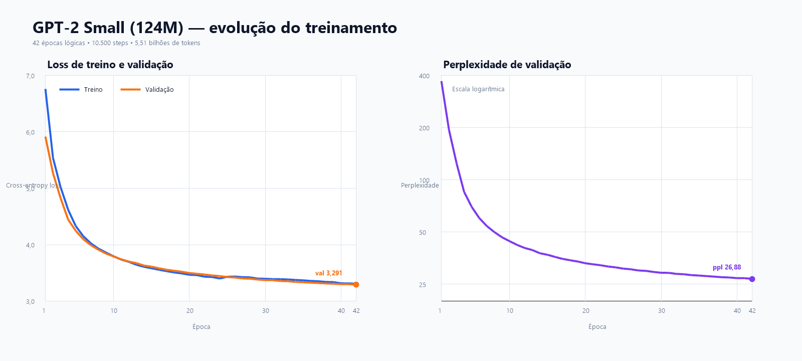

# GPT-2 Small (124M) treinado do zero

[](https://huggingface.co/itlrc/gpt2-small)

Implementação e pipeline de treinamento de um modelo causal de linguagem com arquitetura equivalente ao GPT-2 Small. O modelo foi treinado do zero sobre o `sample-10BT` do FineWeb-Edu, usando o tokenizer GPT-2 do `tiktoken`.

Este repositório contém o pipeline, o código e as métricas do experimento. Os pesos treinados são distribuídos separadamente no [Hugging Face Hub](https://huggingface.co/itlrc/gpt2-small), evitando adicionar arquivos binários grandes ao histórico do Git.

## Modelo publicado

O checkpoint de inferência está disponível em [`itlrc/gpt2-small`](https://huggingface.co/itlrc/gpt2-small). O repositório do modelo contém os pesos em Safetensors FP32, a configuração da arquitetura e a integração personalizada com Transformers.

| Recurso | Local |
|---|---|
| Código e pipeline de treinamento | Este repositório |
| Pesos para inferência | [Hugging Face](https://huggingface.co/itlrc/gpt2-small) |
| Dataset utilizado | [FineWeb-Edu](https://huggingface.co/datasets/HuggingFaceFW/fineweb-edu) |

## Resultados

O último checkpoint completo corresponde ao final da época lógica 42.

| Item | Resultado |
|---|---:|
| Parâmetros | 124.439.808 |
| Atualizações do otimizador | 10.500 |
| Tokens processados | 5.505.024.000 |
| Train loss | 3,3080 |
| Validation loss | 3,2915 |
| Validation perplexity | 26,88 |
| HellaSwag | 27,68% em 10.042 exemplos |



A acurácia aleatória esperada no HellaSwag com quatro alternativas é 25%. Portanto, o resultado deve ser interpretado como uma avaliação inicial, e não como desempenho competitivo.

## Arquitetura

- 12 blocos Transformer;
- 12 cabeças de atenção por bloco;
- dimensão de embedding de 768;
- contexto máximo de 1.024 tokens;
- vocabulário de 50.257 tokens;
- pesos compartilhados entre o embedding de tokens e a cabeça de linguagem;
- atenção causal com `scaled_dot_product_attention` do PyTorch.

## Configuração do treinamento

- Dataset: `HuggingFaceFW/fineweb-edu`, configuração `sample-10BT`;
- carregamento do corpus em streaming;
- tokenizer GPT-2;
- batch efetivo de 524.288 tokens por atualização;
- 250 atualizações por época lógica;
- AdamW com betas `(0.9, 0.95)` e weight decay de `0.1`;
- gradient clipping em `1.0`;
- warmup seguido de cosine decay;
- validação em uma partição fixa de documentos reservados.

Como o dataset é consumido em streaming, “época” neste projeto significa um intervalo lógico de 250 atualizações, e não uma passagem completa por todo o corpus.

## Conteúdo do repositório

```text
.
├── artifacts/
│   ├── training_curves.png
│   ├── training_history.csv
│   └── training_history.json
├── notebooks/
│   ├── gpt2small.ipynb
│   └── gpt2small_kaggle_quickstart.ipynb
├── scripts/
│   ├── export_checkpoint.py
│   └── plot_history.py
├── src/nano_gpt/
│   ├── generate.py
│   └── model.py
├── config.json
├── MODEL_CARD.md
├── pyproject.toml
└── requirements.txt
```

`notebooks/gpt2small.ipynb` documenta a configuração do treinamento efetivo. `notebooks/gpt2small_kaggle_quickstart.ipynb` é uma variante curta para validar o pipeline no Kaggle antes de iniciar uma execução longa. A implementação reutilizável da arquitetura está em `src/nano_gpt/model.py`, enquanto as métricas extraídas do treinamento estão em `artifacts/`.

## Instalação

Requer Python 3.10 ou mais recente e uma versão do PyTorch compatível com o hardware disponível.

```bash
python -m venv .venv
```

Linux ou macOS:

```bash
source .venv/bin/activate
python -m pip install --upgrade pip
pip install -e ".[training]"
```

Windows PowerShell:

```powershell
.venv\Scripts\Activate.ps1
python -m pip install --upgrade pip
pip install -e ".[training]"
```

Para carregar diretamente o modelo publicado no Hub, instale também a integração opcional:

```bash
pip install -e ".[hub]"
```

## Executando o pipeline

Para inspecionar a configuração que produziu o modelo publicado, abra `notebooks/gpt2small.ipynb`. Para um teste rápido no Kaggle, use `notebooks/gpt2small_kaggle_quickstart.ipynb`; essa variante usa apenas 5 épocas lógicas, 100 steps por época e limita temporariamente o HellaSwag a 100 exemplos.

Antes de iniciar um novo treinamento, ajuste no notebook escolhido:

- o diretório dos checkpoints;
- `B` de acordo com a memória da GPU;
- `STEPS_PER_EPOCH` e `NUM_EPOCHS` para o orçamento de tokens desejado;
- `VAL_STEPS` para o custo de validação aceitável.

O dataset é carregado diretamente do Hugging Face em streaming, portanto é necessário acesso à internet durante o treinamento.

## Métricas e gráficos

O histórico completo por época está disponível em formatos JSON e CSV. Para gerar novamente as curvas a partir desses dados:

```bash
python scripts/plot_history.py
```

## Usando o modelo publicado

Como a arquitetura foi implementada neste projeto, o carregamento pelo Transformers utiliza `trust_remote_code=True`:

```python
import torch
from transformers import AutoModelForCausalLM, AutoTokenizer

repo_id = "itlrc/gpt2-small"

tokenizer = AutoTokenizer.from_pretrained("gpt2")
model = AutoModelForCausalLM.from_pretrained(
    repo_id,
    trust_remote_code=True,
    torch_dtype=torch.float32,
)

inputs = tokenizer("Hi! I'm a", return_tensors="pt")
with torch.inference_mode():
    output = model.generate(
        **inputs,
        max_new_tokens=64,
        do_sample=True,
        temperature=0.8,
        top_k=50,
    )

print(tokenizer.decode(output[0], skip_special_tokens=True))
```

`trust_remote_code=True` é necessário porque o Hub precisa carregar `configuration_nanogpt.py` e `modeling_nanogpt.py` junto com os pesos. Revise código remoto antes de habilitar essa opção em modelos de terceiros.

Para checkpoints produzidos localmente pelo notebook, o comando `meu-gpt2-generate` continua disponível. O utilitário `scripts/export_checkpoint.py` separa pesos de inferência, configuração e histórico do checkpoint completo.

## Limitações

- O treinamento registrado foi interrompido durante o início da época 43.
- O modelo não recebeu instruction tuning, RLHF ou outro alinhamento por preferências.
- As gerações podem conter erros factuais, repetições, vieses ou conteúdo inadequado.
- O resultado do HellaSwag está próximo da linha de base aleatória.
- Este é um experimento educacional e de pesquisa, não um sistema pronto para produção.

## Licença

Uma licença ainda não foi definida. Até que uma licença seja adicionada, o código não deve ser considerado liberado para reutilização irrestrita.
